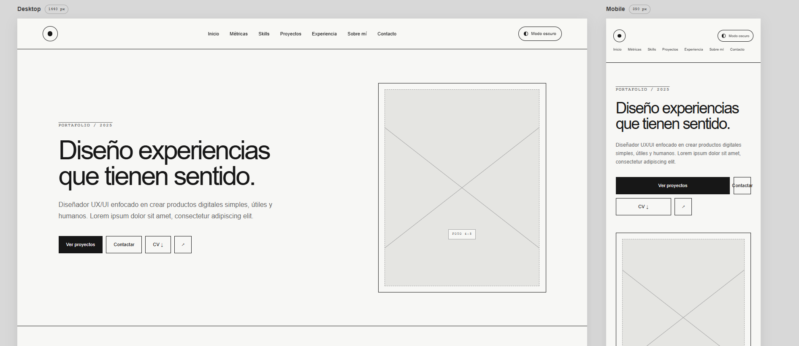
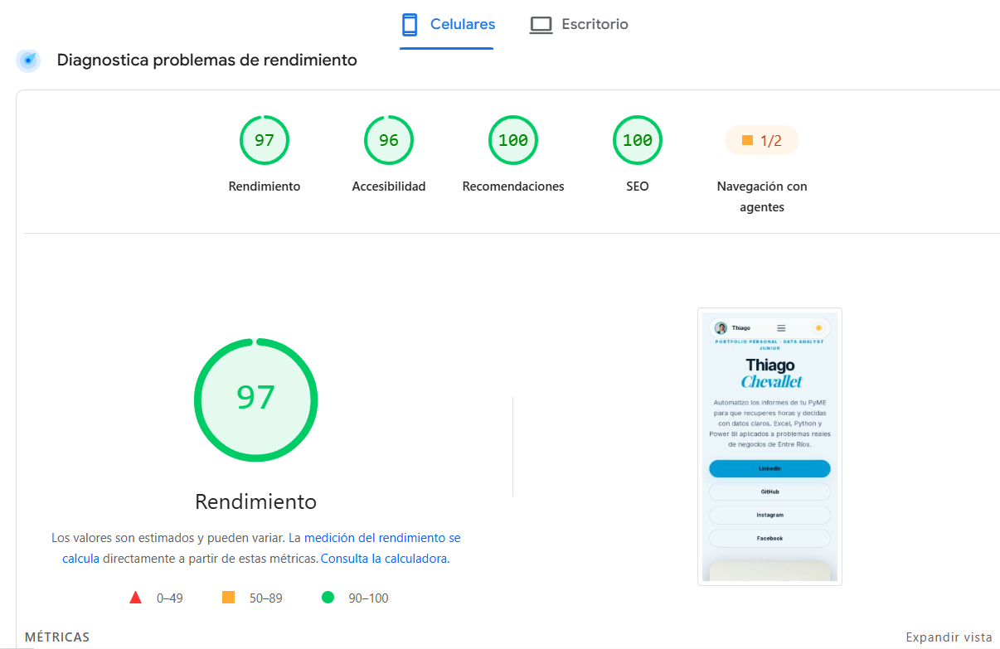
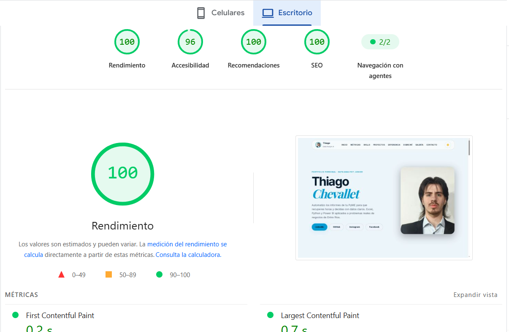

# 🛡️ Portfolio Web Personal - Thiago Chevallet

## 📐 Prototipo y Wireframe en Figma

Antes de escribir la primera línea de código, diseñé la arquitectura de información y los wireframes en Figma para definir la jerarquía visual y el flujo de navegación.

[](https://www.figma.com/make/2NWlTb30rrRjLGbq4FXPtK/Wireframe-Portfolio-Thiago-Chevallet)

> *Hacé clic en el botón para ver el prototipo interactivo generado con Figma Make.*



## 📝 Sobre el proyecto

Este es mi portafolio web personal, desarrollado como Trabajo Final para la cátedra de **Diseño UX/UI** (Licenciatura en Sistemas - UADER FCyT).

El objetivo del sitio es presentar mi perfil profesional como **Data Analyst Junior**, mostrando mis habilidades técnicas, proyectos destacados y mi experiencia en la automatización de datos para PyMEs.

## 🚀 Demo
Podés ver el sitio en vivo acá: 
👉 **[https://kecleon20.github.io/Thiago-Chevallet/](https://kecleon20.github.io/Thiago-Chevallet/)**

## 📊 Auditoría de Rendimiento (Lighthouse)

El sitio fue auditado con Google Lighthouse, obteniendo puntajes casi perfectos en todas las categorías, tanto en la versión Mobile como en Desktop.

| Categoría | Mobile | Desktop |
| :--- | :---: | :---: |
| **Rendimiento (Performance)** | 🟢 97 | 🟢 100 |
| **Accesibilidad (Accessibility)** | 🟢 96 | 🟢 96 |
| **Recomendaciones (Best Practices)** | 🟢 100 | 🟢 100 |
| **SEO** | 🟢 100 | 🟢 100 |
| **Navegación con agentes** | 🟠 1/2 | 🟢 2/2 |

### Capturas de la auditoría
| Mobile Benchmark | Desktop Benchmark |
| :---: | :---: |
|  |  |

*Nota técnica: La puntuación de 96 en accesibilidad se debe a pequeños contrastes de color en algunos textos secundarios sobre fondos con transparencia (glassmorphism). Se optó por priorizar la identidad visual del diseño, manteniendo un nivel de legibilidad óptimo.*

## 🛠️ Tecnologías utilizadas
*   **HTML5** semántico.
*   **CSS3** (Variables, Flexbox, CSS Grid, animaciones con `@keyframes`).
*   **JavaScript Vanilla** (Módulos ES6, manipulación del DOM, IntersectionObserver).
*   **Git y GitHub Pages** (para el despliegue).
*   **Formspree** (para el formulario de contacto funcional).

## 📂 Estructura del proyecto

```text
/
├── index.html          # Página principal con las 9 secciones
├── caso-cubri.html     # Página interna del caso de estudio (Proyecto 1)
├── styles.css          # Hoja de estilos principal y sistema de diseño
├── script.js           # Lógica de menú, tema oscuro/claro y animaciones
├── robots.txt          # Configuración para buscadores
├── sitemap.xml         # Mapa del sitio para SEO
├── 404.html            # Página de error personalizada
├── 404.css             # Estilos específicos de la página 404
└── assets/             # Carpeta con imágenes, CV y certificados🎨 Proceso de Diseño (UX/UI)

Investigación y Referencias: Se analizaron portfolios de la industria para definir un estilo visual moderno, oscuro y minimalista.

Sistema de Diseño: Se definieron tokens de color (variables CSS), tipografías (Inter y Playfair Display) y espaciados.

Wireframes y Prototipo: Se diseñaron los wireframes en Figma antes de pasar al código.

Maquetado: Se implementó un diseño 100% responsive (Mobile-first) utilizando CSS Grid y Flexbox.

Accesibilidad: Se aplicaron prácticas de accesibilidad (WCAG), como el "Skip to content", atributos aria-label, alto contraste y navegación por teclado.

📸 Capturas del Sitio
Inicio (Desktop)	Proyectos	Experiencia
https://assets/captura-inicio.jpg	https://assets/captura-proyectos.jpg	https://assets/captura-experiencia.jpg

Desarrollado por Thiago Chevallet · 2026